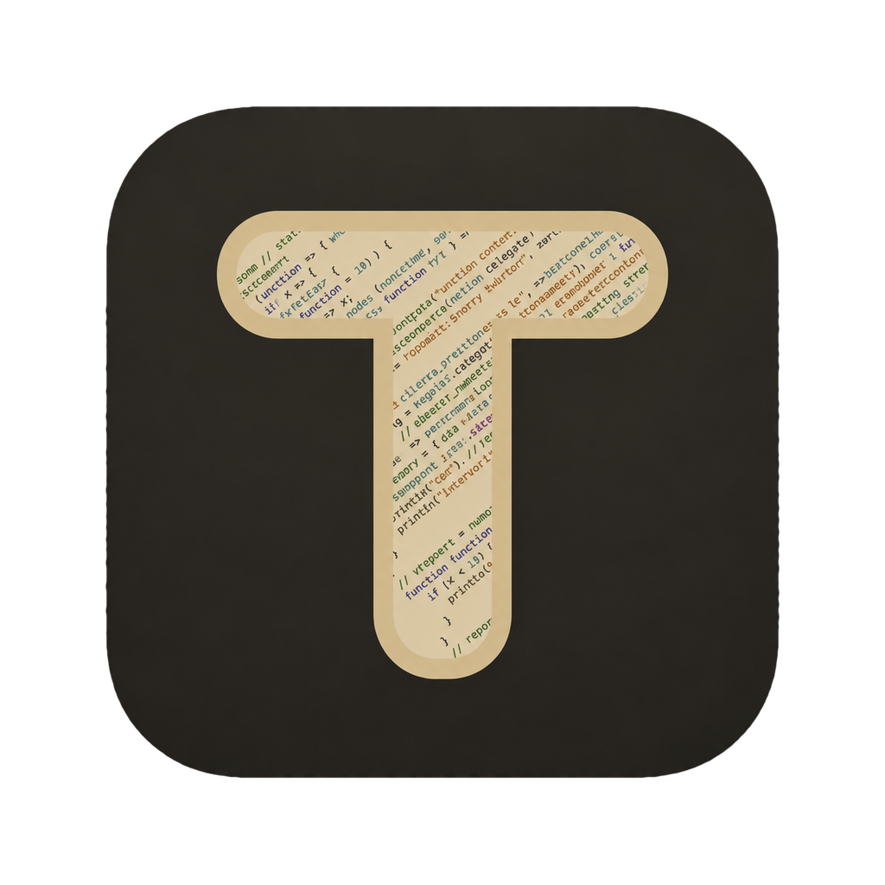

# TodeX Desktop

<p align="center">
  <picture>
    <source media="(prefers-color-scheme: dark)" srcset="src/renderer/assets/brand/t-icon-dark-beige.png" />
    <source media="(prefers-color-scheme: light)" srcset="src/renderer/assets/brand/t-icon-light.png" />
    
  </picture>
</p>

<p align="center">
  <strong>Native macOS desktop client for <code>todex-agentd</code> built with Electron, React 19, and BoardUI.</strong>
</p>

<p align="center">
  <a href="README.md">English</a> •
  <a href="README.zh-CN.md">简体中文</a>
</p>

---

## Overview

**TodeX Desktop** is a desktop client for [`todex-agentd`](../TodeX_backend), delivering a coding workspace environment on macOS.

Built with **Electron 44**, **React 19**, **Vite 7**, **Tailwind CSS v4**, and **BoardUI**, TodeX Desktop features a 3-pane layout optimized for wide screens. It shares the transport and protocol library (`@todex/protocol`, from [`TodeX_protocol`](../TodeX_protocol)) with the web client, while leveraging native desktop capabilities like local file pickers and multi-tab developer workbenches.

---

## Key Features

- **Desktop 3-Pane Interface**:
  - **Left Sidebar**: Workspace directory explorer, active conversation history, agent switcher badges, thread lifecycle actions (New, Rename, Fork, Delete), and quick settings.
  - **Center Chat Panel**: Full conversation timeline with streaming Markdown rendering, Shiki syntax highlighting, KaTeX math formulas, interactive approval cards (commands, file diffs, tool calls), and prompt input with searchable model selection (case-insensitive name matching), draggable reasoning effort, Codex Fast mode, a two-level `@` reference menu (pick a type, then search: `@file:`, `@folder:`, `@chat:` to attach another conversation of the workspace as Markdown, `@skill:`, `@mcp:`, `@ssh:` for SSH hosts with agent access, `@app:` for apps on the backend computer for Computer Use), `/` slash commands, and `#` skill/MCP suggestions. Reasoning and tool details are lazily mounted only after expansion, while final answers remain isolated from context and execution events.
  - **Right Workbench Panel**: Multi-tab workspace drawer offering:
    - **Slash Commands**: Reference of provider commands.
    - **Git Diff**: Live inspection of working directory changes.
    - **Terminal**: Embedded xterm.js PTY session with direct keyboard input, ANSI output, and automatic row/column synchronization.
    - **Capabilities**: Real-time read-only catalog of active Skills and MCP servers.
    - **Browser**: Loopback pages and workspace HTML files in a native view (own `persist:todex-preview` partition), with an element picker that adds a reference to the chat draft. `localhost` means the backend's computer: every loopback request is forwarded through the backend's `POST /v2/browser/proxy` (over the encrypted transport), so a dev server on a remote backend host opens under its own origin. WebSockets (dev-server hot reload) are not forwarded yet; use Refresh.
    - **Agent browser**: When agent desktop tools are on, a live view of the browser tab the agent drives for the current conversation on the backend's computer (streamed over the session socket), with its latest step and a Stop button.
  - **Terminal view (sidebar)**: Manage the backend host's SSH hosts (auto-read from `~/.ssh/config`, manual add/import, connection test, per-host Agent access, plus a built-in `Local` host that opens a login terminal on the backend machine over `ssh localhost` on Linux/macOS backends), SSH keys (list, import, generate) and FTP sites; open SSH terminals and SFTP/FTP file browsers as Workbench tabs.
    - **Experiments**: Feature toggles and developer diagnostics.
- **Pairing & Connection Management**:
  - Inspect the active Backend's Codex, Pi, Claude Code, Grok Build, and ACP CLI inventory, compare installed and latest versions, install missing CLIs in one click, and start managed CLI upgrades.
  - Export and import one agent's provider accounts as a JSON file to sync them between hosts (the file holds keys in plain text).
  - Connect via direct host/port URL; requests are signed with the per-device key enrolled through device verification.
  - [Device verification](docs/device-verification.md) (pairing v3, commit then reveal): enter only the backend address, compare the random code (and the transport key fingerprint) with the backend TUI and approve once. The code also authenticates the backend's transport public key, so approval enrolls this device's signing key and pins that key in one step, then connects.
  - No manual key entry, paste or QR import: Settings shows the pinned protocol, key fingerprint and verified state read-only, with a **Re-pair** action. Changing the address clears the device key and the pin; re-pairing the same backend keeps the device key.
  - **Parallel backends**: Settings › Backend connections manages every backend (add, remove); opening one shows its connection, device verification and history encryption. Each backend stays connected and serves its own workspaces, so switching workspaces never disconnects or reconnects. New conversations outside any workspace (None) start on the backend chosen there, by default the first one added.
  - Clear connection diagnostic states (categorizes connection errors such as unstarted backend, port mismatch, token error, deprecated `/v1` endpoints, or handshake issues).
- **Native OS Integration**:
  - Secure Electron architecture: Preload bridge with isolated context (`contextBridge`) and `nodeIntegration: false`.
  - Native file and directory chooser dialogs for loopback local workspaces.
  - Electron `userData` file persistence (`todex.desktop.*`).
- **Agent desktop tools** (`todex_desktop` MCP, switched on per backend in Settings; the Settings overview keeps the switch and one entry per tool, each opening the tool's own page):
  - The **agent browser** (`browser_*`) runs in the backend, as a Chromium window on the computer the backend runs on (so `localhost` is that computer); this app only watches it live in the Workbench. Any paired device approves a conversation's first use. Top-level pages are limited to loopback; downloads and site permission prompts are refused; typing into a password field asks first.
  - The agent browser's settings page shows the backend's Chromium (download it there) and its per-workspace browser profiles (switch, create, delete with their cookies, storage and cache). Data left from when the browser ran in this app can be cleared from the Settings overview.
  - **Computer Use** (`computer_*`) runs in the backend on the computer it runs on, not here: this app shows a live view of that computer above the composer (the latest screenshot when the live frame is unavailable) with Stop, and its settings page shows the host's switch and Screen Recording / Accessibility status and asks for them there. Each conversation's first use is confirmed by someone at that computer.
- **Transport Encryption** ([transport v2](docs/device-verification.md#传输加密transport-v2)):
  - **X25519** or **ML-KEM-768** (post-quantum) key agreement against the backend key pinned at pairing, via the `@noble` cryptography suite; every session key mixes in fresh server randomness.
  - With a pinned key every call is encrypted, loopback included: the WebSocket uses `tv=2` binary frames and every REST request goes through the `POST /v2/sealed` tunnel. Only `/health`, `/v2/transport-policy` and device verification are called directly.
  - Without a pinned key only a loopback backend can be reached (in plaintext); a remote address is refused with a prompt to pair with encryption. A changed backend protocol asks for re-pairing instead of downgrading, and a key saved without device-pairing verification (older manual imports) is refused on every host, loopback included, until the backend is paired again.
- **End-to-end encrypted history** ([history encryption](docs/device-verification.md#历史记录加密)): conversation history is always encrypted; there is no switch. Each device registers its own history key on first connect, and Settings warns until a recovery key is set. Conversations stored before encryption are read-only (view, export, archive, delete).

---

## Architecture & Relation to Mobile App

```
+-----------------------------------------------------------------------------------+
|                                  TodeX Desktop                                    |
|                                                                                   |
|  +-----------------------------------------------------------------------------+  |
|  |                            Electron Main & Preload                          |  |
|  |       (IPC Handlers, Native Dialogs, Safe Storage, Window Management)       |  |
|  +-----------------------------------------------------------------------------+  |
|                                         |                                         |
|  +-----------------------------------------------------------------------------+  |
|  |                             React 19 Renderer                               |  |
|  |  +-------------------+  +------------------------+  +--------------------+  |  |
|  |  |    Left Sidebar   |  |    Center Chat Panel   |  |   Right Workbench  |  |  |
|  |  |  (Workspaces &    |  |  (Timeline, Streaming, |  |  (Git Diff, PTY,   |  |  |
|  |  |   Conversations)  |  |   Approvals, Inputs)   |  |   Skills, MCPs)    |  |  |
|  |  +-------------------+  +------------------------+  +--------------------+  |  |
|  |  +-----------------------------------------------------------------------+  |  |
|  |  |                 BoardUI components (source-owned)                     |  |  |
|  |  +-----------------------------------------------------------------------+  |  |
|  +-----------------------------------------------------------------------------+  |
|                                         |                                         |
|  +-----------------------------------------------------------------------------+  |
|  |                @todex/protocol (Shared, from TodeX_protocol)               |  |
|  |         (v2 Client, Transport, Heartbeat, Crypto Sessions, Probes)          |  |
|  +-----------------------------------------------------------------------------+  |
+-----------------------------------------------------------------------------------+
                                          |
                               WebSocket / REST /v2
                                          v
+-----------------------------------------------------------------------------------+
|                             todex-agentd (Backend)                                |
+-----------------------------------------------------------------------------------+
```

### Desktop vs Mobile Comparison

| Dimension | Mobile Client (`Todex_mobile`) | Desktop Client (`TodeX_desktop`) |
| :--- | :--- | :--- |
| **Framework** | Swift + UIKit | Electron 44 + React 19 (Vite) |
| **UI Components** | UIKit (Liquid Glass) | BoardUI + React Aria (Tailwind v4) |
| **Layout** | Mobile Stack Navigation | 3-Pane Resizable Desktop Layout |
| **Protocol Layer** | Swift port (`TodexCore`) | `@todex/protocol` alias mapped to `../TodeX_protocol/src` |
| **Local Storage** | iOS Keychain / local persistence | Electron `userData` JSON (`todex.desktop.*`); device and history keys sealed with the OS keychain (safeStorage) |
| **Pairing Input** | Camera scan of the address QR, then device verification | Backend address, then device verification |

---

## Prerequisites & Setup

### Requirements

- **Node.js**: 22.0.0 or higher
- **pnpm**: 11.0.0 or higher
- **TodeX Backend**: A `todex-agentd` instance. Settings → **Local backend** can deploy one on this machine (see below), or connect to any running instance (default `http://127.0.0.1:7345`).
- **BoardUI Pro key (optional)**: BoardUI components are committed as source, so installing dependencies needs no key. Only adding a BoardUI Pro component needs one, read from `BOARDUI_KEY`.

### 1. Check Out the Shared Protocol

The renderer imports `@todex/protocol` from a sibling `../TodeX_protocol` checkout.
To add BoardUI components later:

```bash
pnpm dlx @collectui/bdui add <name> -p src/renderer                    # free components
pnpm dlx @collectui/bdui add <name> -p src/renderer --key "$BOARDUI_KEY" # Pro components
```

> [!WARNING]
> Do not commit API keys or auth tokens to the repository.

### 2. Install Dependencies

```bash
pnpm install
```

*Note: If the Electron binary download is interrupted, run:*

```bash
rm -rf node_modules/electron/dist
node node_modules/electron/install.js
```

### 3. Launch Development Mode

```bash
pnpm run dev
```

The desktop window will launch at 1280×800.

---

## Available Scripts

| Command | Description |
| :--- | :--- |
| `pnpm run dev` | Runs `predev` checks and starts the Electron app in Vite dev mode. |
| `pnpm run dev:demo` | Serves the renderer alone with in-memory demo data for design previews; open the printed `?demo` URL in a browser. |
| `pnpm run build` | Builds the main process, preload script, and renderer assets. |
| `pnpm run package` | Builds and packages the Electron application with electron-builder. |
| `pnpm run preview` | Previews the production build locally. |
| `pnpm run typecheck` | Validates TypeScript types across main and renderer targets. |
| `pnpm run check:electron` | Verifies that the native Electron binary is intact. |
| `pnpm run test:updates` | Unit tests for the main-process policies, plus the static IPC contract between preload and main (`scripts/ipc-contract.test.ts`). |
| `pnpm run test:visual` | Screenshot regression of the main screens in the `?demo` preview (headless Chromium, light and dark). |
| `pnpm run test:electron` | Builds main + preload and smoke-tests the real Electron shell against an isolated, offline profile. |

### Tests

`test:visual` compares full-window screenshots under `tests/visual/__screenshots__` against the demo preview with a fixed clock and reduced motion. Baselines are rendered only in CI's `mcr.microsoft.com/playwright` image, since fonts rasterize differently elsewhere, so local runs show diffs but must not overwrite baselines. A new screenshot fails CI until its baseline is committed; that run renders it: download the `visual-baselines` artifact of the *Desktop checks* run and commit it. After an intended UI change, run *Desktop checks* manually (`gh workflow run checks.yml --ref <branch> -f update-screenshots=true`) and commit the re-rendered artifact. Open `playwright-report/` or the `visual-report` artifact to inspect diffs.

`test:electron` gives the app its own `HOME` and `XDG_CONFIG_HOME` and a backend URL nobody serves, so it never touches the real profile or a daemon; native dialogs are replaced in main via `electronApp.evaluate`. On a Wayland desktop pass `TODEX_E2E_ELECTRON_ARGS=--ozone-platform=wayland`; CI runs it under `xvfb-run`. The window is shown while the tests run.

## Desktop Releases

Desktop packages are created manually from **Actions > Release desktop packages**.
Enter a stable semantic version such as `1.2.3`; after validation, the workflow
injects it into the application metadata and About page in Settings, then publishes Windows
x64 and ARM64 NSIS installers, a macOS Apple Silicon DMG, a Linux x64 AppImage,
and SHA-256 checksums to the `v1.2.3` GitHub Release.

Development builds display `DEV0.0.0`; `package.json` keeps the valid placeholder
version `0.0.0` until packaging receives a release version from CI.

### Development logs

Detailed desktop diagnostics are enabled only for builds whose version is exactly
`DEV0.0.0`. By default they are written to
`Electron userData/logs/todex-desktop-debug.log`; the resolved path is persisted in
`todex-desktop-store.json` under `todex.desktop.debug.logPath`. Set
`TODEX_DESKTOP_LOG_PATH` to override it for a local run. Logs include window, IPC,
HTTP, WebSocket, and uncaught-error events, while redacting or truncating tokens,
cookies, keys, and attachment contents.

Windows packages are unsigned, so SmartScreen may require approval on first launch.
macOS releases now require signing; see [automatic updates](docs/automatic-updates.md)
for the required GitHub Actions secrets and migration from unsigned installations.
The build checks out the mobile
repository's `main` branch beside this repository because the desktop client shares
its protocol source, then pins the resolved commit across every platform. If that
repository is private, configure a `PROTOCOL_REPO_TOKEN` Actions secret with read
access.

---

## Local Backend

Settings → **Local backend** runs `todex-agentd` on this computer without a terminal:

- **Deploy and connect** downloads the backend release with the same version as this Desktop (the latest release for dev builds) from GitHub, checks it against the release's `SHA256SUMS` and its `--version`, keeps it under `userData/backend/bin/<version>/`, and starts the daemon with the shared data directory `~/.todex-agent` (the same one the backend CLI and TUI use). A daemon that is already running is adopted instead.
- Desktop talks to it over a local IPC channel (a Unix socket, or a named pipe on Windows), not TCP: profiles of these backends have the URL `todex-ipc://local`. Pairing is approved automatically through the backend's socket-only local-admin API, which accepts only processes of the same OS user.
- A Desktop-managed daemon does not self-update; when Desktop updates, **Switch to matching version** restarts it on the matching build.
- The page mirrors the backend TUI: listen address and port, pairing encryption, workspace roots, start at login, resets, the pairing QR code and transport fingerprint, and approving, rejecting or revoking devices. The listener stays on `127.0.0.1` until you change it; set `0.0.0.0` or an interface IP (and restart) to let other TodeX clients pair with this machine.
- Once Desktop is connected over IPC, the **Network listener** switch can turn TCP off (after a restart): other devices, browsers and the web client can no longer connect, only Desktop's IPC connection remains, and agent tools keep working through an internal loopback-only port. Turn it back on here or in the backend TUI (press `b`).
- TodeX containers are managed under Settings → **TodeX Container** (below).

## TodeX Container

Settings → **TodeX Container** runs agents in [TodeX containers](https://github.com/youtonghy/TodeX_container) on this machine's Docker:

- **Docker environment** checks the `docker` CLI, the daemon (not installed, not running, or no permission — e.g. not in the `docker` group), Compose v2, whether containers can share their local socket, and which image tags are present.
- **Containers** lists every container labeled `io.todex.instance`. Ones created by `todexc` or Desktop live under `~/.config/todex-container/<name>/` (`settings.env`, `mounts`, `compose.yaml`, in exactly the format `todexc` writes, so either tool can manage them) and can be started, stopped, restarted, upgraded (pull and recreate), remounted, inspected (logs) and deleted; deleting keeps the home volume `todex-<name>-home` unless you tick it. Plain `docker compose` containers can only be started, stopped, connected and inspected. Containers sharing their socket also get the backend admin cards of the Local backend page.
- **Automatic cleanup** (a minute after start, then every 6 hours): remove TodeX image versions no container uses (on by default), remove containers stopped for 1/7/30 days (settings and home volume kept), unmount folders no workspace of this app uses once the container is idle, and stop Desktop-created containers when TodeX quits. Home volumes are never deleted automatically.
- **New workspace → Container workspace** picks a host folder and a container (or a new one: free name `todex`, `todex-2`, …), mounts the folder (same path on Linux and macOS, `/workspace/<folder>` on Windows; a running container is recreated, after a confirmation when a turn runs there), waits for the backend, pairs and connects, and creates the workspace at the folder's container path. It then offers to install agent CLIs in the container and to copy agent config (accounts, settings, MCP, skills) from another connected backend with config sync.
- **Setup commands** (Container workspace, first step): a template picker (suggested from the folder's lockfiles: pnpm, npm, yarn, uv, requirements.txt, git submodules) and an editable list of commands. Once the workspace exists they run one by one in the container at the workspace path as the `todex` user (`bash -c`, stopping at the first failure), with live output; they can go on in the background and report when done.
- **Auto-freeze** (off by default; 15 min to 4 h): a container whose backend had no running or permission-waiting turn, running terminal, or queued/scheduled prompt for that long — as this Desktop sees it — is frozen with `docker pause` (processes and memory kept) and its connection closed quietly. Sending in one of its conversations, opening a terminal or one of its workspaces, or **Resume** on the settings page thaws it and reconnects; the held message is then sent. Other devices using the container are not visible to this Desktop.
- On Linux, Desktop pairs over the container's shared socket (`todex-ipc://container-<name>`), and containers it creates publish no host port (`TODEX_PUBLISH=0`, todexc `--no-publish`). Docker Desktop, rootless Docker, Podman and userns-remap cannot use the socket: Desktop publishes the container on `http://127.0.0.1:<port>` (recreating a socket-only one) and approves the pairing with `docker exec … todex-agentd pair approve`.
- **Host ports**: a published container gets a random free port from the range in Settings → TodeX Container (17345–17444 by default), never the native backend's port (its configured one, 7345 when unknown, also while it is stopped). A container whose port is taken, or that sits on the native backend's port, moves to a new port when Desktop starts or recreates it, and running ones on the native port move at launch (Docker restarts them at boot). The old port is kept in `former-ports`, and a paired profile still aimed at it is re-pointed once a sealed request with its pinned key succeeds on the new port.

## Connection & Troubleshooting

The Settings screen in TodeX Desktop provides clear diagnostic feedback:

| Diagnostic State | Cause | Resolution |
| :--- | :--- | :--- |
| **Backend Unreachable** | Cannot reach `/v2/version` or `/health`. | Ensure `todex-agentd` is running and the port is correct. |
| **Invalid Backend URL** | The provided URL cannot be parsed. | Use a standard origin format such as `http://127.0.0.1:7345`. |
| **Authentication Failed** | HTTP 401/403 returned by backend. | Enter the correct `Auth Token` matching the backend configuration. |
| **Deprecated Protocol** | The URL path contains `/v1`. | Update the connection URL to use `/v2`. |
| **WebSocket Failure** | HTTP probes succeed but `/v2/ws` fails. | Check network firewall rules. A `4400` close means the pinned key does not match: re-pair in Settings → Device verification. |
| **Encrypted pairing required** | A remote backend without a pinned transport key, or the backend now requires another protocol. | Run device verification (or **Re-pair**) in Settings; approval pins the key. |
| **Agent Unavailable** | Provider shows `available = false`. | Verify that the underlying agent CLI (`codex`, `pi`, `claude`) is installed and authenticated. |

---

## Security

- **Process Isolation**: The renderer process runs with `nodeIntegration: false` and `contextIsolation: true`.
- **Preload IPC**: Dialogs, secure storage and the workspace file actions (open, open with, reveal) are routed through guarded IPC channels. The renderer cannot read local files through IPC; the file actions accept absolute paths only, and a plain open refuses executables and app bundles.
- **App window**: Navigation, redirects and subframe navigation are limited to the app's own entry; web permissions other than notifications and clipboard writes are denied.
- **Backend origin**: The bundled renderer's WebSockets send `Origin: todex-desktop://app` instead of `file://` (or `null`); anonymous loopback backends accept that value and refuse `null` / `file://`. This needs a backend with the matching origin rule.
- **Strict Scope**: Only connects to explicitly configured agent daemon endpoints.
- **Browser views**: Workbench pages run in sandboxed `WebContentsView`s with their own partition, never the app's storage; their top-level navigation is checked in the main process.

---

## Related Repositories

- **[TodeX Backend](../TodeX_backend)**: Rust backend daemon (`todex-agentd`).
- **[TodeX Protocol](../TodeX_protocol)**: Shared `@todex/protocol` sources consumed by this client and the web client.
- **[Todex Mobile](../Todex_mobile)**: Swift + UIKit mobile app.

---

## License

This project is licensed under the MIT License - see the [LICENSE](LICENSE) file for details.

## App icons

Desktop and Web share the same T artwork, with light and dark variants for the interface and documentation. See [app icon assets](docs/app-icons.md) for previews, file roles, and update instructions.
