# TodeX Desktop

<p align="center">
  <picture>
    <source media="(prefers-color-scheme: dark)" srcset="src/renderer/assets/brand/t-icon-dark-beige.png" />
    <source media="(prefers-color-scheme: light)" srcset="src/renderer/assets/brand/t-icon-light.png" />
    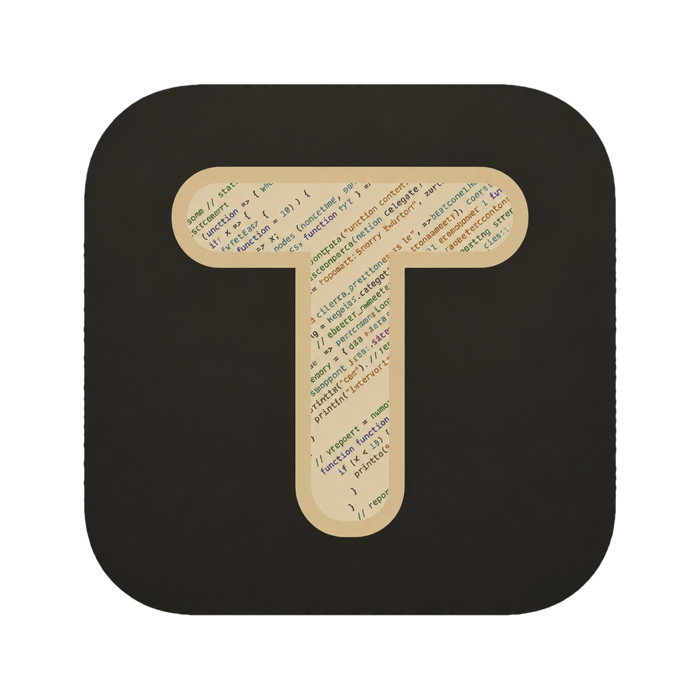
  </picture>
</p>

<p align="center">
  <strong>One desktop workspace for every coding agent you run: Codex, Claude Code, Pi, Grok Build, OpenCode and more, on this computer or on any backend you pair with.</strong>
</p>

<p align="center">
  <a href="README.md">English</a> · <a href="README.zh-CN.md">简体中文</a>
</p>

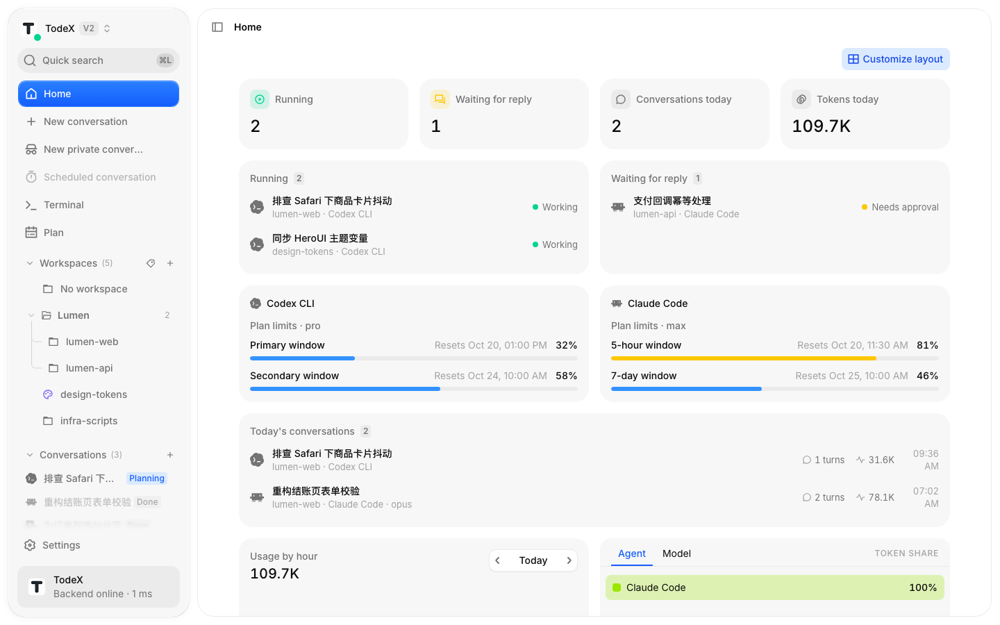

TodeX Desktop is the desktop client of TodeX. It connects to one or more TodeX backends (`todex-agentd`), which run the agent CLIs on their machine, and gives you one place to start conversations, follow agents live, approve their actions, review their changes and manage the machines they work on. It runs on macOS, Windows and Linux, in light and dark themes, in English, 简体中文, 日本語 and 한국어.

## Contents

- [Home at a glance](#home-at-a-glance)
- [Conversations](#conversations)
- [Models, reasoning and work modes](#models-reasoning-and-work-modes)
- [Plans and the task board](#plans-and-the-task-board)
- [Private conversations and scheduled send](#private-conversations-and-scheduled-send)
- [Workbench, terminal and SSH](#workbench-terminal-and-ssh)
- [Agent desktop tools: browser and Computer Use](#agent-desktop-tools-browser-and-computer-use)
- [Backends, groups and config sync](#backends-groups-and-config-sync)
- [Agent CLI management](#agent-cli-management)
- [Agent Calling](#agent-calling)
- [Usage profile](#usage-profile)
- [Local backend and TodeX containers](#local-backend-and-todex-containers)
- [Security and privacy](#security-and-privacy)
- [Install and get started](#install-and-get-started)
- [Development](#development)

## Home at a glance

The home page shows what needs you right now: conversations that are running, conversations waiting for your reply or approval, today's conversations and token usage, and each agent's plan limits (for example Claude Code's 5-hour and 7-day windows) with their reset times. **Customize layout** adds, removes and rearranges the cards.

| Light | Dark |
| :---: | :---: |
|  | 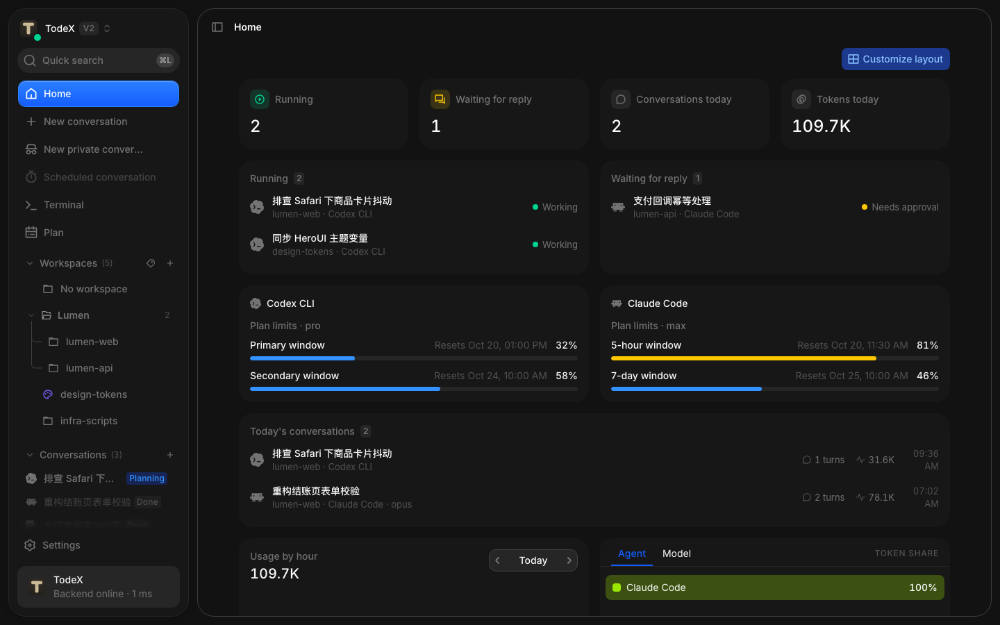 |

## Conversations

The sidebar groups workspaces into folders and lists their conversations with live status (running, waiting, planning, done). Open one to follow the agent as it works:

- Streaming answers with Markdown, highlighted code and math. Each run's steps fold into one line ("Edited 1 file · Ran 1 command") that expands to the commands, file diffs and tool calls.
- Approval cards for commands, file edits and tool calls, answered once or for the whole conversation.
- The header shows the agent, Git branch, worktree and the size of the change.
- Rename, pin, fork (also from any reply), archive and delete conversations.
- The composer takes images and files by paste or drag and drop, and has three quick menus: `@` references a file, folder, another conversation, a skill, an MCP server, an SSH host or an app for Computer Use; `/` runs the agent's slash commands; `#` suggests skills and MCP servers.
- Messages you send while the agent is busy wait in a queue. Conversations keep running when you close the window, because the backend runs them, and every paired device sees the same state.

| Light | Dark |
| :---: | :---: |
| 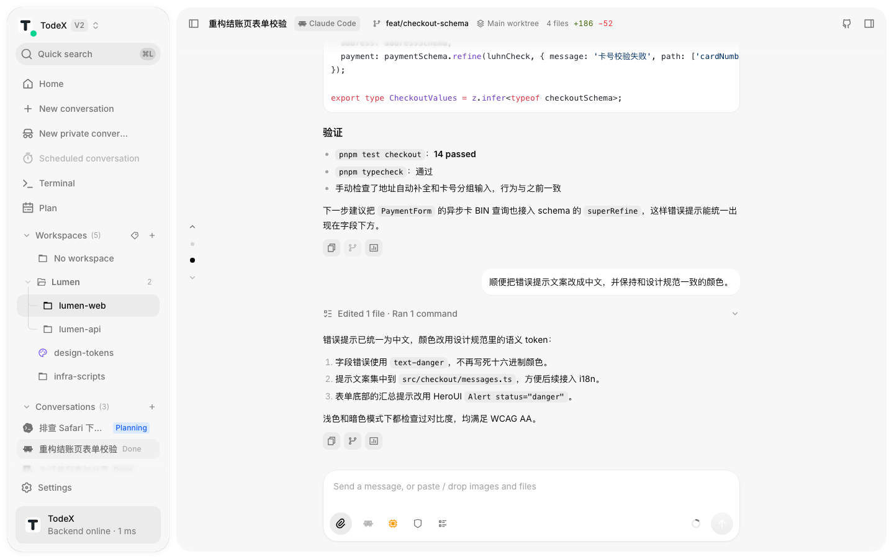 | 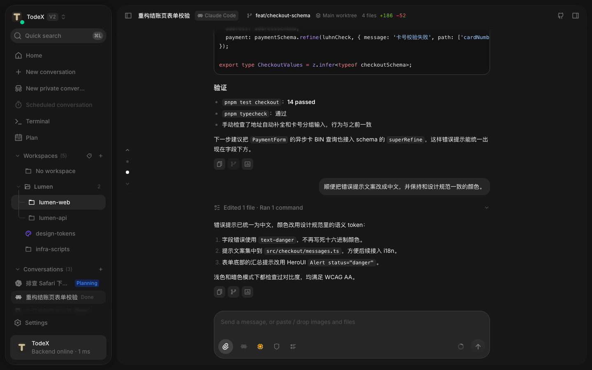 |

While an agent works, its plan checklist and its goal stay above the composer, so you can see how far it has come without scrolling.

| Plan steps of a running turn | Agent goal |
| :---: | :---: |
| 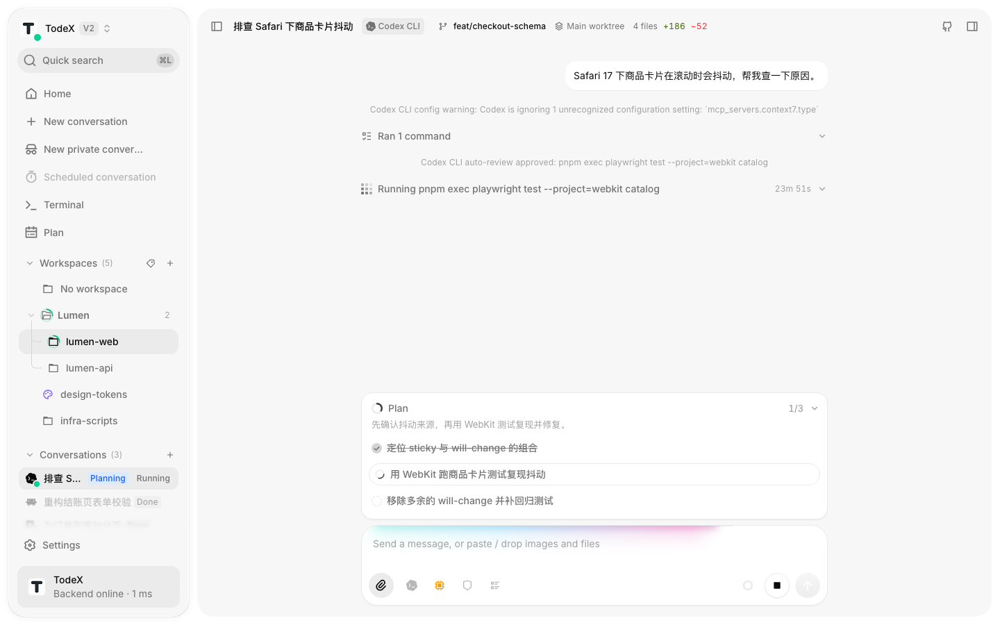 | 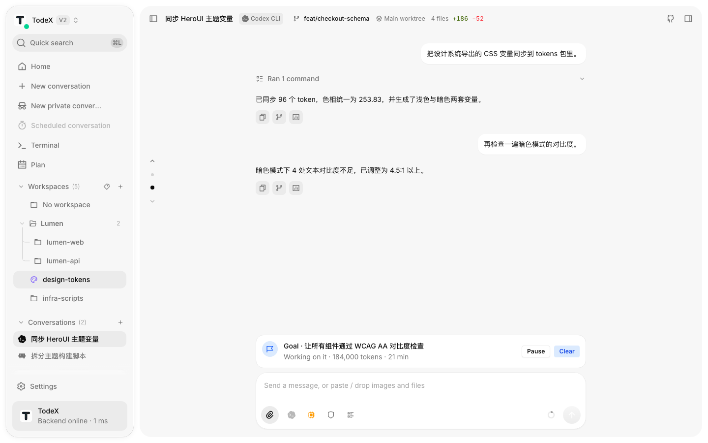 |

## Models, reasoning and work modes

Pick the model from a searchable list and drag the reasoning effort; Codex also offers Fast mode. Each conversation has a work mode: **Implement**, **Plan** (the agent proposes a plan for you to review first) or, for Claude Code, **Smart**: plan with one model, then, once you approve the plan, switch to an execution model that runs with auto-approval.

| Model and reasoning effort | Work modes |
| :---: | :---: |
| 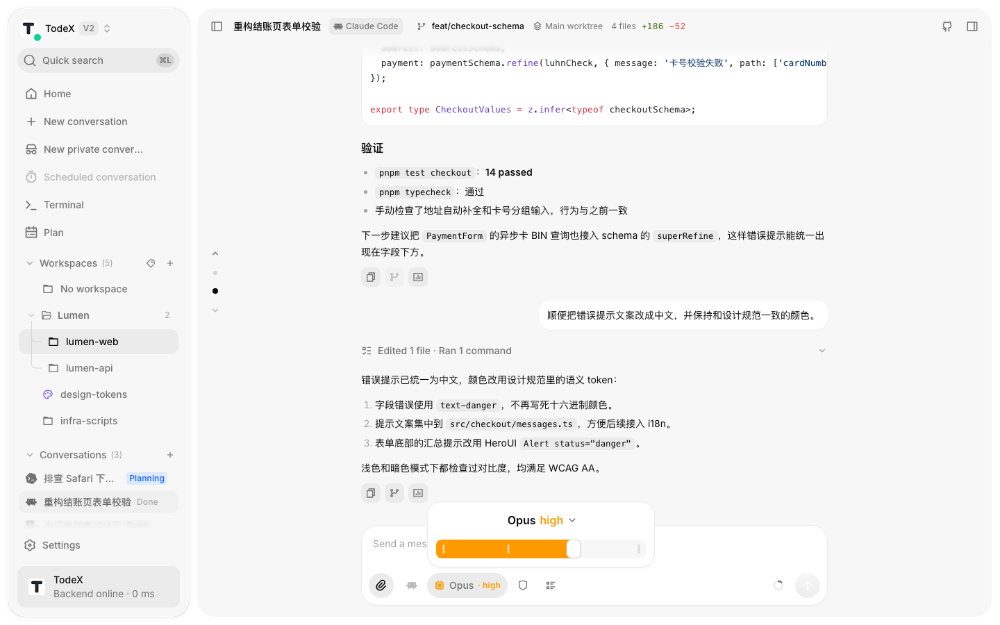 | 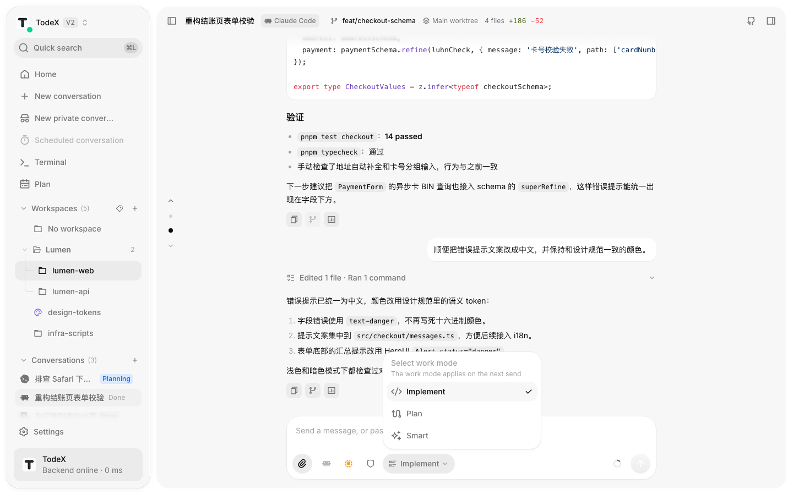 |

## Plans and the task board

**Plan** is a task board per workspace: tasks with priority, due date and status, pinned to the conversations that work on them. Switch between the board and a calendar.

| Board | Calendar |
| :---: | :---: |
| 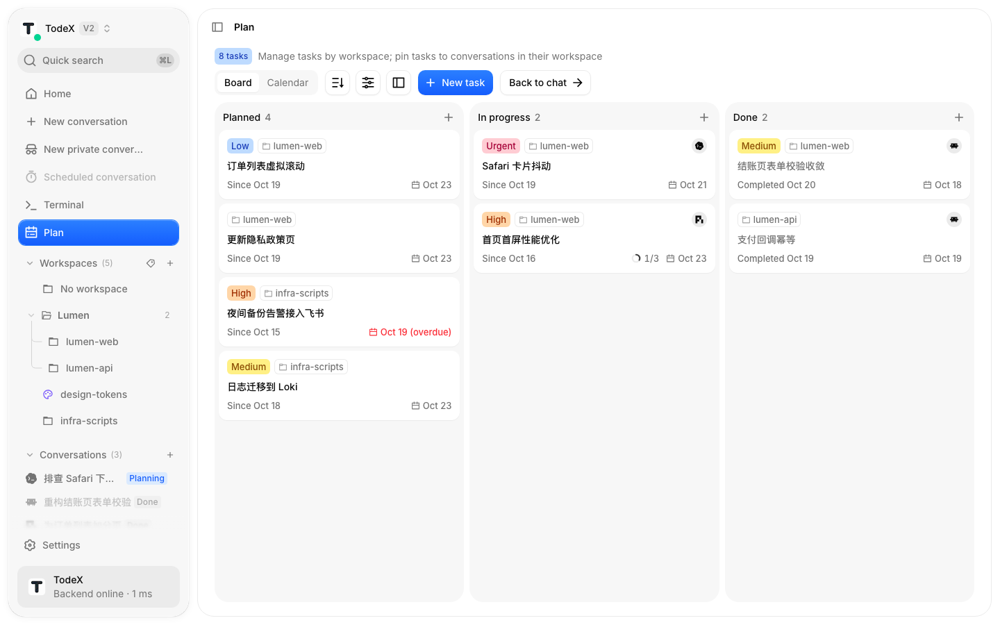 | 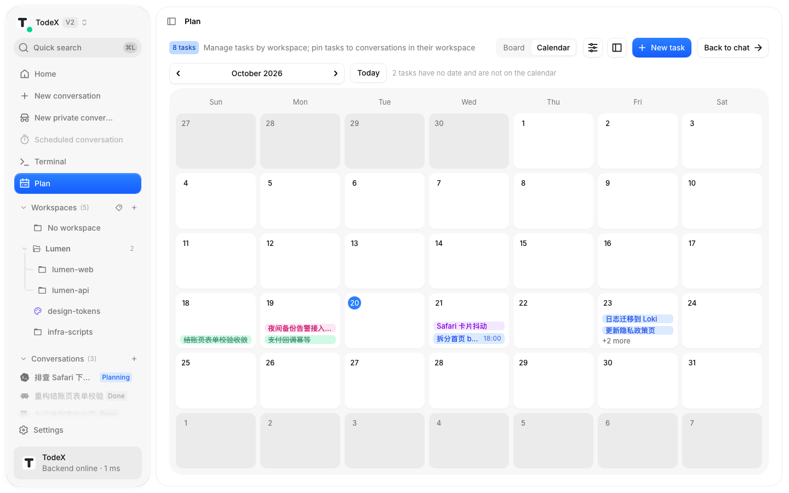 |

## Private conversations and scheduled send

A **private conversation** keeps its content only in the backend's memory: nothing goes into history, and it is gone after a restart (changes the agent makes to workspace files are kept as usual). **Scheduled send** (the timer button next to Send) sends the message at the time you pick, even while the app is closed. It works in a new or an existing conversation and uses that conversation's agent, model and settings. Until then the backend holds anything else sent in the conversation and sends it at the same time. A backend restart drops the held messages and marks the schedule interrupted.

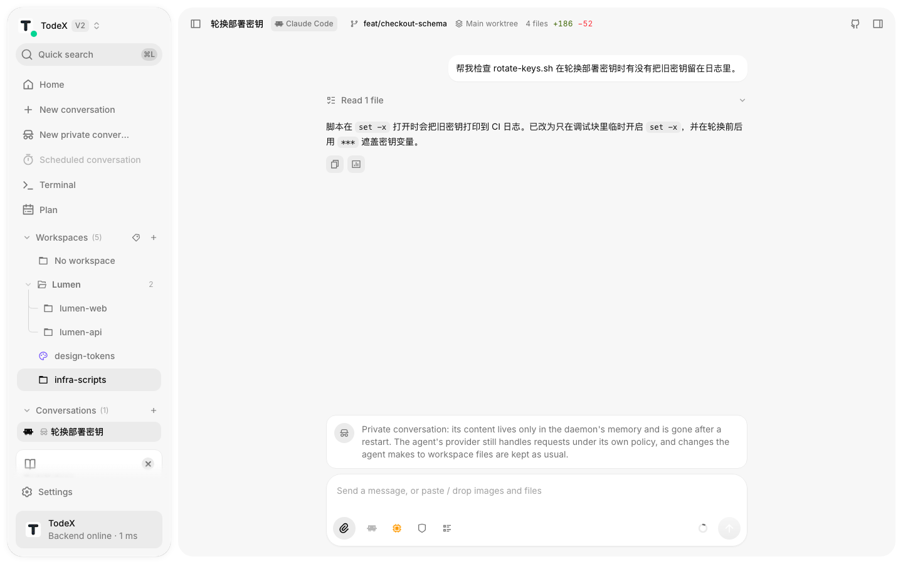

## Workbench, terminal and SSH

The workbench opens beside the conversation as tabs: the Git diff of the working tree, terminals on the backend machine, workspace files, a browser for local dev servers (with an element picker that adds a reference to your message), and live views of what the agent is doing.

The **Terminal** page manages the backend machine's SSH hosts (read from `~/.ssh/config`, added by hand or imported, plus a built-in `Local` host), SSH keys (list, import, generate), FTP sites, open connections and port forwarding. Hosts open as terminals or SFTP/FTP file browsers in the workbench. Turn on **Agent access** for a host to let agents run commands there, approved per conversation or per command.

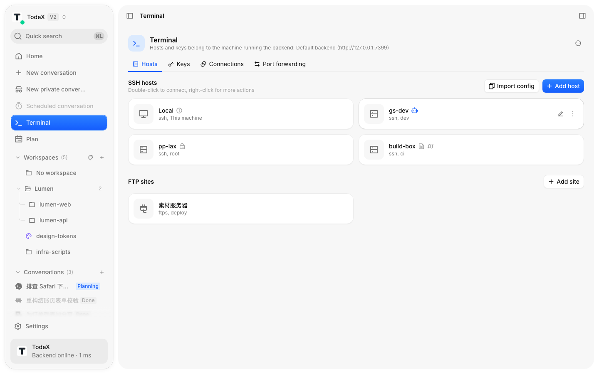

## Agent desktop tools: browser and Computer Use

Turn on agent desktop tools for a backend and agents can work on that backend's computer:

- **Agent browser**: the agent drives a real browser tab there (so `localhost` is that computer), with its own browser profile per workspace. You watch it live; any paired device approves a conversation's first use, and sites beyond the local machine need approval, once or always.
- **Computer Use**: the agent sees and operates that computer's apps. Someone at that computer confirms each conversation's first use, and a live view with a **Stop** button appears in the app, as a workbench tab or above the composer.

| Live view of Computer Use | Settings |
| :---: | :---: |
| 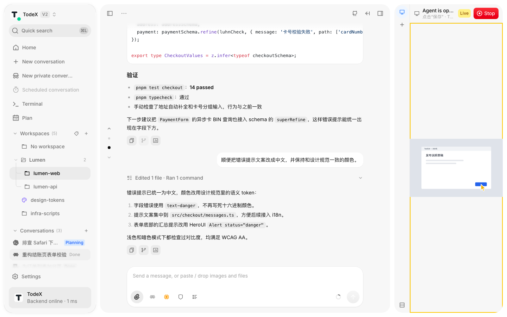 | 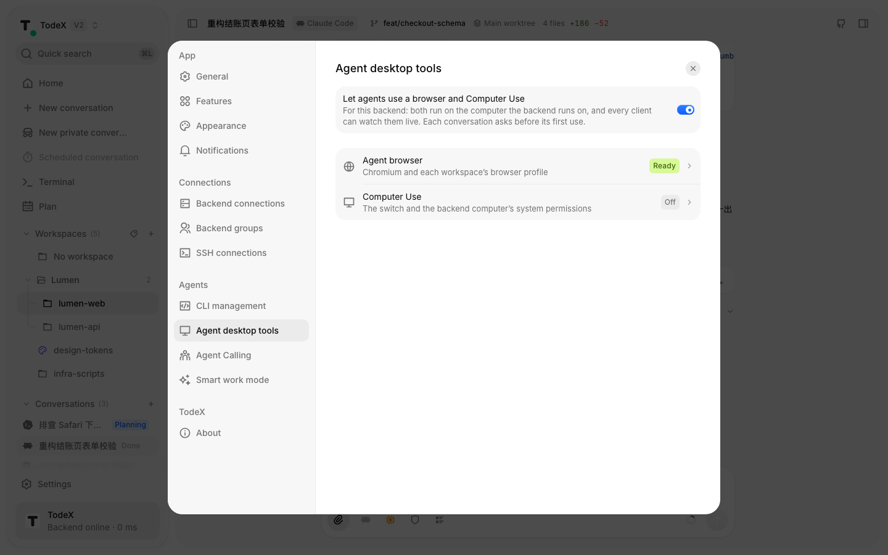 |

## Backends, groups and config sync

TodeX Desktop stays connected to every backend you add, so switching workspaces never reconnects. Pairing a backend takes only its address and a code you compare with the backend before approving; there are no tokens or keys to copy.

**Backend groups** join devices and backends into one group: approve a new device by comparing its code, invite one with a QR code, and reach a backend through another member of the group when its own address doesn't answer (relayed traffic stays end-to-end encrypted). Mark a backend with a public address as the group's **hub**: the other backends and devices reach it first for everyone's latest address and relay through it, then switch to a direct connection as soon as one works. **Config sync** compares two backends side by side and copies the agent accounts, settings, MCP servers and skills you tick; nothing on the target is deleted and secrets stay hidden.

| Backend connections | Backend groups |
| :---: | :---: |
| 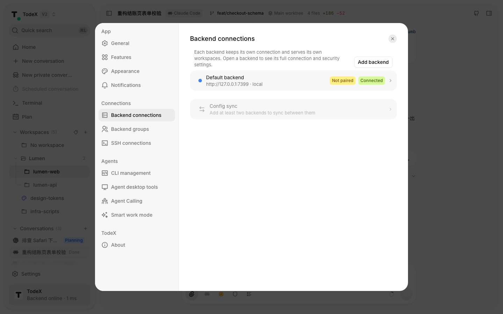 | 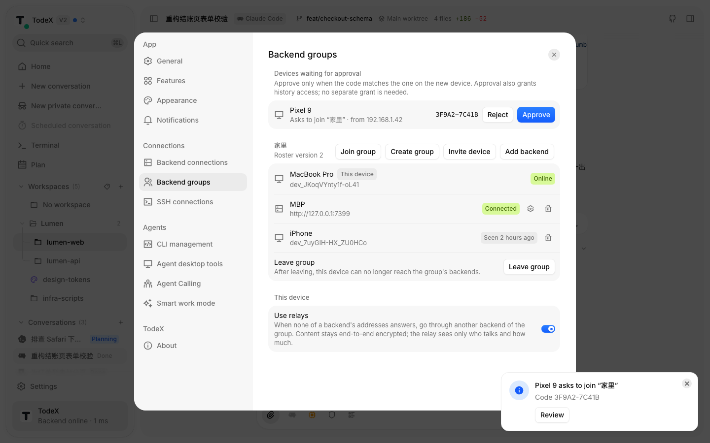 |

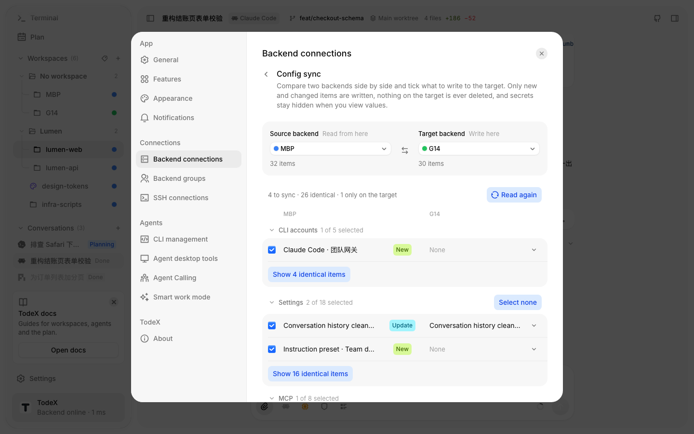

## Agent CLI management

See every agent CLI on a backend with its installed and latest version, update it in one click, and install the ones that are missing. Switch between an agent's provider accounts, and export or import them as a file to move them between machines (the file holds keys in plain text). Shared MCP servers, skills and `AGENTS.md` presets live on the same page.

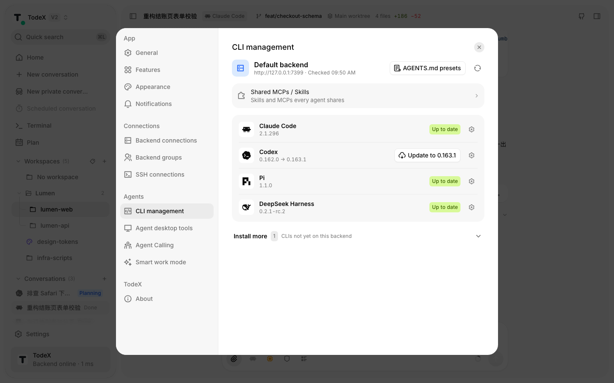

## Agent Calling

Agents can call each other: an agent in a conversation hands a task to another agent and model in a child conversation of the same workspace. You choose which agents and models can be called and how their permission requests are answered. The same scope applies to scripts and services that call agents through the backend's external API with an API key, which you also create here.

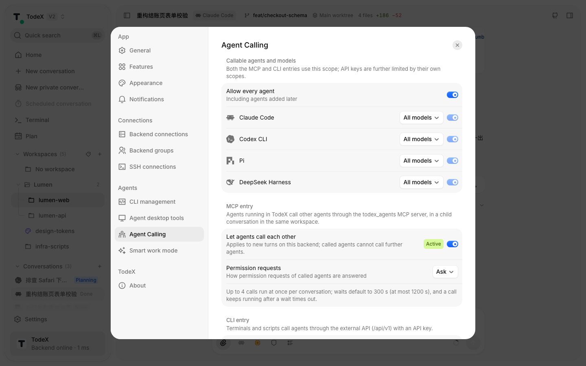

## Usage profile

The profile page adds up token usage per agent and model: input, output, cache reads and writes, cache hit rate, an activity heatmap, active hours and active conversations per month.

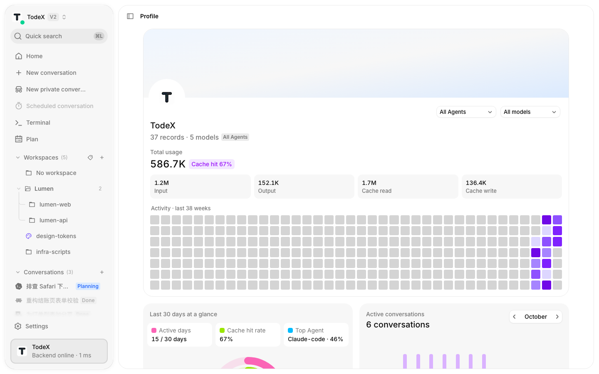

## Local backend and TodeX containers

You don't need a terminal to run a backend:

- **Settings › Local backend** downloads the backend release that matches this app, verifies it and starts it on this computer. The app talks to it over a local socket and approves its own pairing. The page mirrors the backend's console: listen address and port, workspace roots, start at login, the pairing QR code, and approving or revoking devices. You can turn the network listener off so that only this app can reach the backend.
- **Settings › TodeX Container** runs agents in [TodeX containers](https://github.com/youtonghy/TodeX_container) on this machine's Docker: check the Docker setup; create, start, stop, upgrade and delete containers; and create a **container workspace** from a host folder, with setup commands (suggested from the folder's lockfiles) and optional copying of agent config from another backend. Idle containers can freeze automatically and wake up when you use them again.

## Security and privacy

- **Device verification**: each device pairs once by comparing a code with the backend. The backend's key is pinned at the same time, and every request is signed by this device.
- **Encrypted transport**: every call to a paired backend is encrypted (X25519 or post-quantum ML-KEM-768), even on the same machine. If the backend's key changes, the app asks you to pair again instead of falling back to plaintext.
- **End-to-end encrypted history**: conversation history is always encrypted with keys your devices hold. Set a recovery key in Settings; a new device gets access when another device approves it.
- The app connects only to backends you added, keeps device and history keys in the system keychain, and opens web pages in isolated views that can't reach the app's data.

Details: [device verification](docs/device-verification.md).

## Install and get started

Download the installer for your platform from [Releases](https://github.com/youtonghy/TodeX_desktop/releases): Windows x64 and ARM64, macOS (Apple Silicon) and Linux x64 (AppImage), with SHA-256 checksums. The app checks for updates and installs a verified one; see [automatic updates](docs/automatic-updates.md). Windows builds are unsigned, so SmartScreen may ask you to confirm the first launch.

Then open **Settings › Local backend** to deploy a backend on this computer, or add an existing one under **Settings › Backend connections** (default address `http://127.0.0.1:7345`) and approve the pairing on that backend.

| What you see | Likely cause | What to do |
| :--- | :--- | :--- |
| Backend unreachable | The backend isn't running, or the address or port is wrong. | Start `todex-agentd` and check the address. |
| Encrypted pairing required | A remote backend that hasn't been paired, or its encryption changed. | Run device verification (**Re-pair**) in Settings. |
| WebSocket failure | Requests work but the live connection doesn't. | Check firewalls and proxies; if the backend's key changed, pair again. |
| Agent unavailable | The agent CLI isn't installed or signed in on the backend. | Install it from **CLI management** and sign in on the backend machine. |

## Development

The app needs a [TodeX_protocol](https://github.com/youtonghy/TodeX_protocol) checkout next to this repository, Node.js 22+ and pnpm 11+.

```bash
pnpm install
pnpm run dev            # run the app in development mode
pnpm run dev:demo       # preview the interface with demo data in a browser (the screenshots above come from it)
pnpm run typecheck
pnpm run test:visual    # screenshot tests of the main screens
pnpm run test:electron  # smoke tests of the desktop shell
pnpm run package        # build installers
```

Screenshot baselines are rendered only in CI; see [AGENTS.md](AGENTS.md#ui-tests-and-visual-regression-ci) for how to refresh them. Development builds (`DEV0.0.0`) write a detailed log to `userData/logs/todex-desktop-debug.log` (override with `TODEX_DESKTOP_LOG_PATH`), with tokens, keys and attachment contents redacted. App icon assets: [docs/app-icons.md](docs/app-icons.md).

## Related repositories

- [TodeX Backend](https://github.com/youtonghy/TodeX_backend): the `todex-agentd` backend that runs the agents
- [TodeX Web](https://github.com/youtonghy/TodeX_web): the same experience in a browser
- [TodeX Native](https://github.com/youtonghy/TodeX_native): the mobile app
- [TodeX Container](https://github.com/youtonghy/TodeX_container): a Docker image with the backend and agent CLIs
- [TodeX Protocol](https://github.com/youtonghy/TodeX_protocol): the client library shared by the desktop and web clients

## License

MIT License.
