# TodeX 桌面端

<p align="center">
  <picture>
    <source media="(prefers-color-scheme: dark)" srcset="src/renderer/assets/brand/t-icon-dark-beige.png" />
    <source media="(prefers-color-scheme: light)" srcset="src/renderer/assets/brand/t-icon-light.png" />
    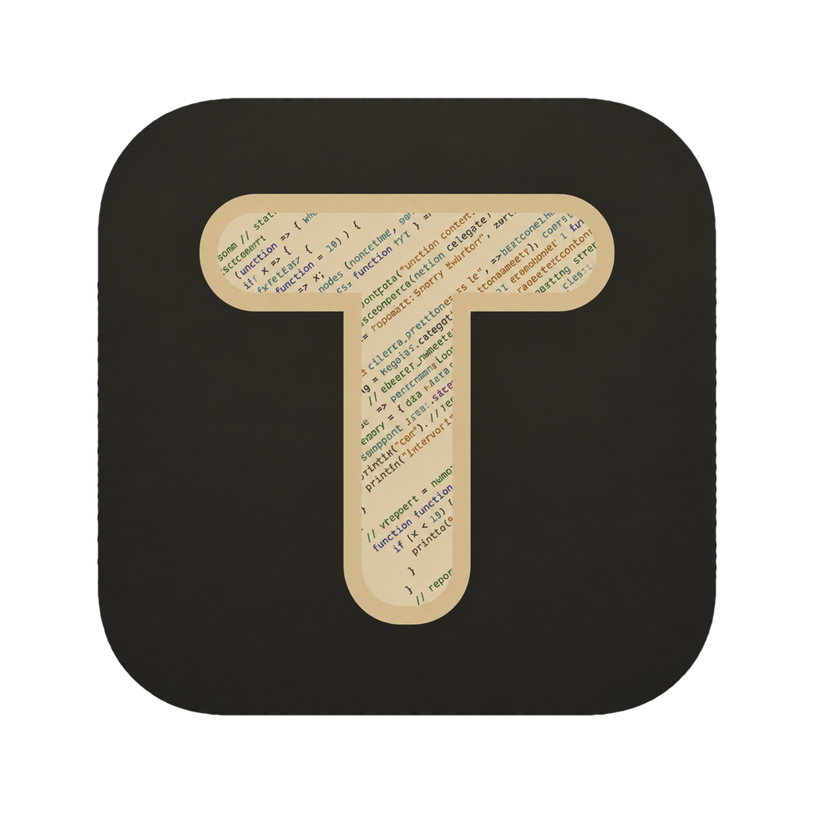
  </picture>
</p>

<p align="center">
  <strong>一个桌面工作台，管理你运行的所有编程 Agent：Codex、Claude Code、Pi、Grok Build、OpenCode 等，无论它们跑在本机还是任何已配对的后端上。</strong>
</p>

<p align="center">
  <a href="README.md">English</a> · <a href="README.zh-CN.md">简体中文</a>
</p>

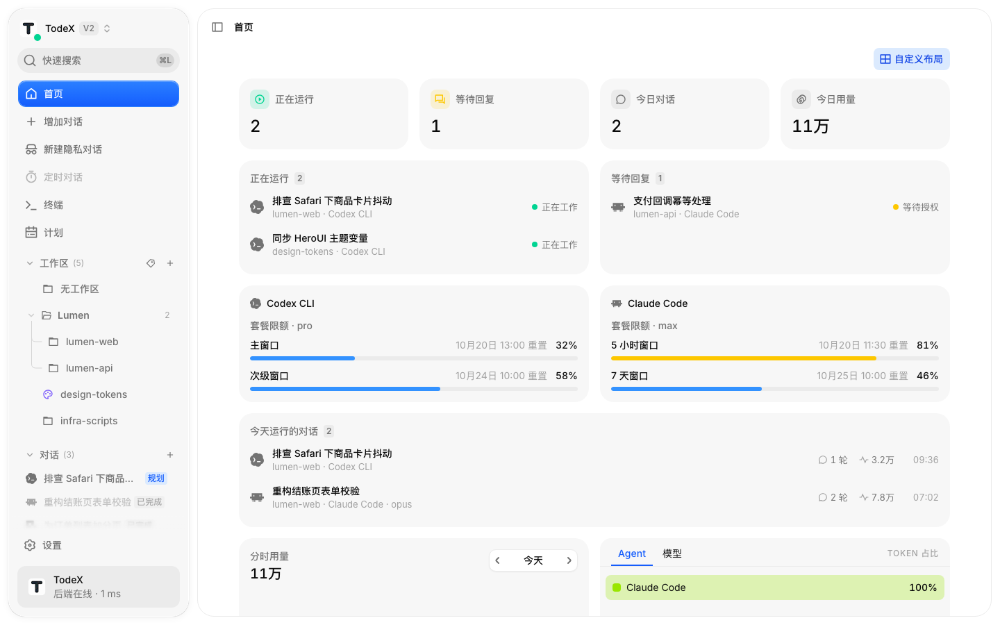

TodeX 桌面端是 TodeX 的桌面客户端。它连接一个或多个 TodeX 后端（`todex-agentd`），由后端在所在机器上运行各个 Agent CLI；你在一个地方就能发起对话、实时跟进 Agent、批准它的操作、检查它的改动，并管理它工作的机器。支持 macOS、Windows 和 Linux，浅色与深色主题，界面语言有 English、简体中文、日本語、한국어。

## 目录

- [首页总览](#首页总览)
- [对话](#对话)
- [模型、思考强度与工作模式](#模型思考强度与工作模式)
- [计划与任务看板](#计划与任务看板)
- [隐私对话与定时发送](#隐私对话与定时发送)
- [工作台、终端与 SSH](#工作台终端与-ssh)
- [Agent 桌面工具：浏览器与 Computer Use](#agent-桌面工具浏览器与-computer-use)
- [后端连接、后端组与配置同步](#后端连接后端组与配置同步)
- [Agent CLI 管理](#agent-cli-管理)
- [Agent 调用](#agent-调用)
- [个人主页](#个人主页)
- [本机后端与 TodeX 容器](#本机后端与-todex-容器)
- [安全与隐私](#安全与隐私)
- [安装与上手](#安装与上手)
- [开发](#开发)

## 首页总览

首页集中展示眼下需要你处理的事：正在运行的对话、等待你回复或授权的对话、今日对话数与 Token 用量，以及各 Agent 的套餐限额（例如 Claude Code 的 5 小时和 7 天窗口）和重置时间。点 **自定义布局** 可以增删、重排卡片。

| 浅色 | 深色 |
| :---: | :---: |
|  | 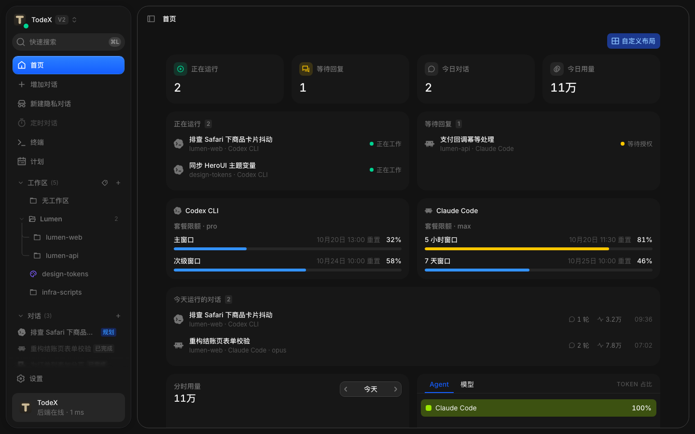 |

## 对话

侧边栏把工作区按文件夹分组，并列出各自的对话和实时状态（运行中、等待中、规划中、已完成）。打开一个对话即可跟进 Agent 的工作：

- 流式回答，支持 Markdown、代码高亮和数学公式。每轮执行的步骤折叠成一行（如“编辑 1 个文件 · 运行 1 条命令”），展开可看命令、文件 diff 和工具调用。
- 命令、文件修改和工具调用的授权卡片，可以只允许一次，也可以在整个对话内允许。
- 标题栏显示 Agent、Git 分支、工作树和改动规模。
- 对话可重命名、置顶、分叉（也能从任意一条回复分叉）、归档和删除。
- 输入框支持粘贴或拖入图片和文件，并有三个快捷菜单：`@` 引用文件、文件夹、其他对话、Skill、MCP 服务器、SSH 主机或 Computer Use 要操作的应用；`/` 执行 Agent 的斜杠命令；`#` 推荐 Skill 和 MCP 服务器。
- Agent 忙时发出的消息会进入队列。关掉窗口对话也会继续运行，因为它由后端执行，所有已配对设备看到的状态都一致。

| 浅色 | 深色 |
| :---: | :---: |
| 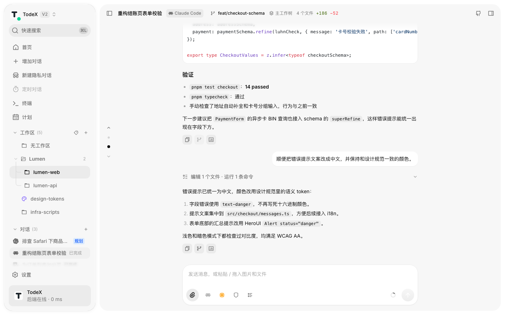 | 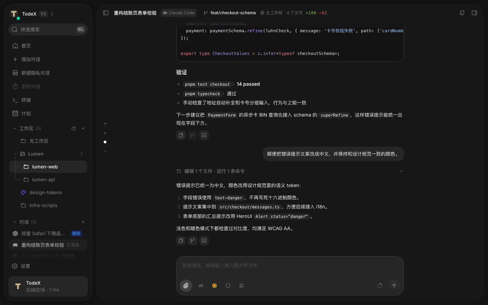 |

Agent 工作时，它的计划清单和目标会固定在输入框上方，不用滚动就知道进展到哪一步。

| 运行中的计划步骤 | Agent 目标 |
| :---: | :---: |
| 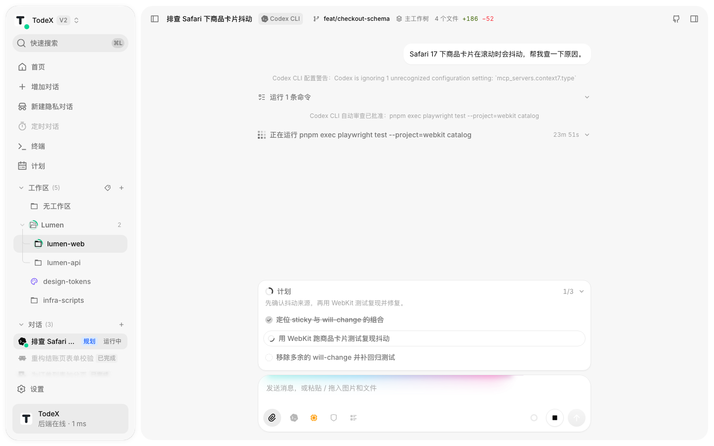 | 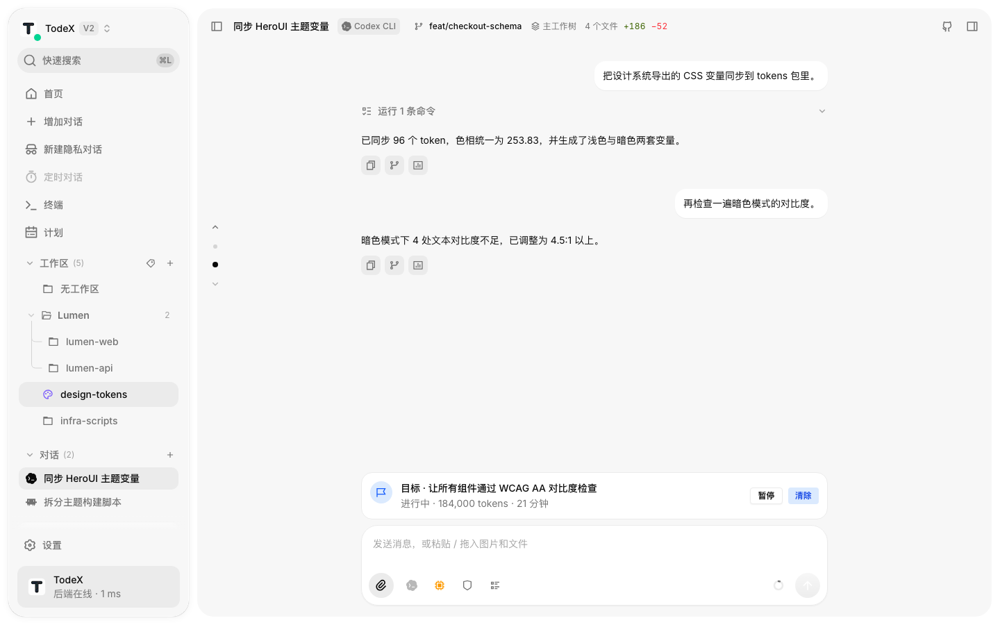 |

## 模型、思考强度与工作模式

在可搜索的列表里选模型，拖动滑块调整思考强度；Codex 还提供 Fast 模式。每个对话都有工作模式：**实现**、**计划**（Agent 先给出计划，由你审阅），以及 Claude Code 的 **智能** 模式：先用一个模型做规划，你批准计划后自动切换到执行模型，并以自动审批的方式执行。

| 模型与思考强度 | 工作模式 |
| :---: | :---: |
| 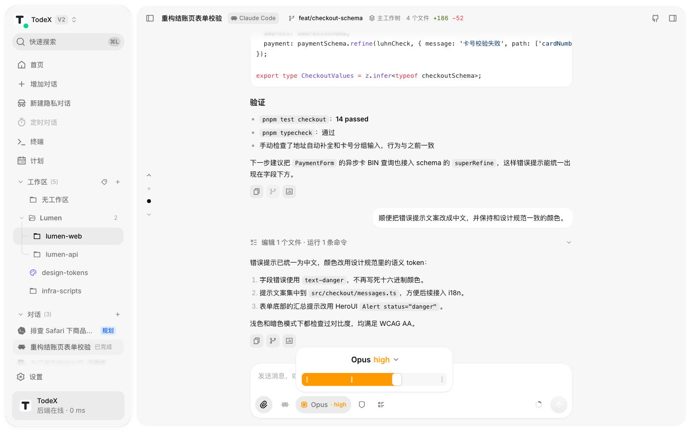 | 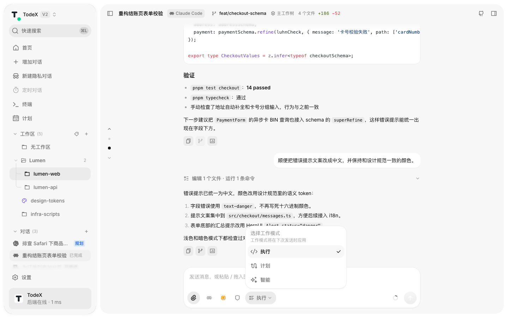 |

## 计划与任务看板

**计划** 是按工作区划分的任务看板：任务有优先级、截止日期和状态，可以固定到处理它的对话上。看板和日历两种视图随时切换。

| 看板 | 日历 |
| :---: | :---: |
| 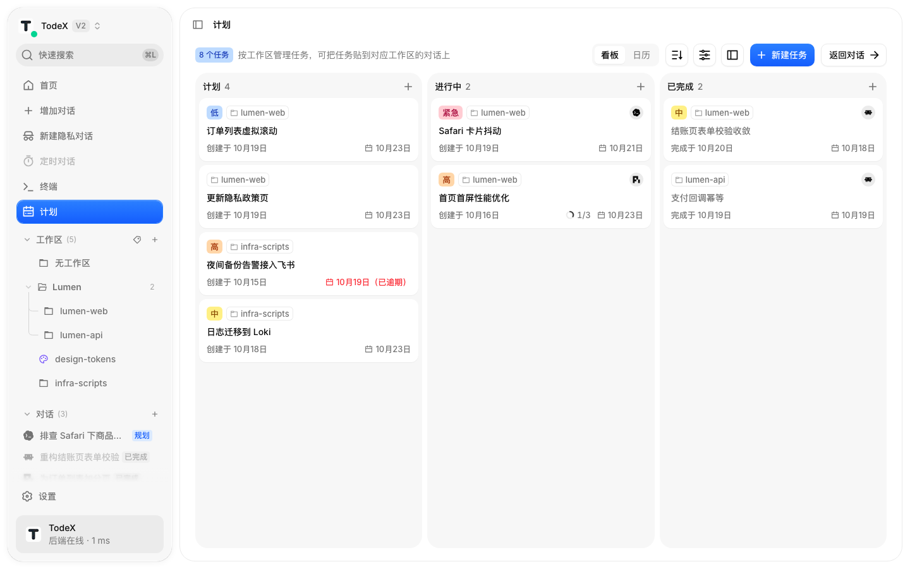 | 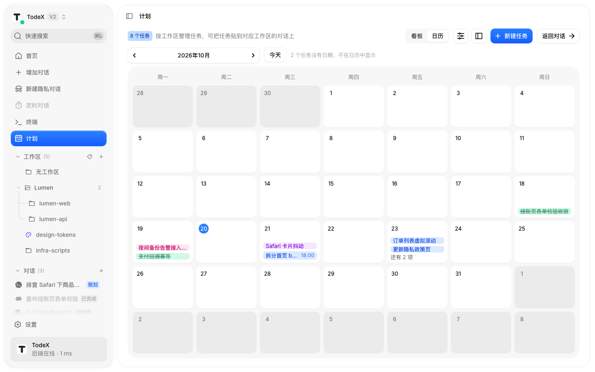 |

## 隐私对话与定时发送

在发送按钮上右键或长按，可以选择这条消息的发送方式。选好后发送按钮旁会显示对应图标（点击图标即取消），再点发送才生效。

- **隐私对话**（也可按 ⇧⌘P）：这条消息会在同一工作区新建一个隐私对话发出，沿用当前的 Agent、模型和设置。隐私对话的内容只保存在后端内存里：不写入历史记录，后端重启后即消失（Agent 对工作区文件的修改照常保留）。隐私发送不支持附件。
- **定时发送**：选择一个时间，消息会在那时发出，即使应用已经关闭，沿用该对话的 Agent、模型和设置。在此之前，该对话里发送的其他消息也会由后端暂存，到点一起发出；后端重启会丢失暂存的消息，并把定时标记为已中断。

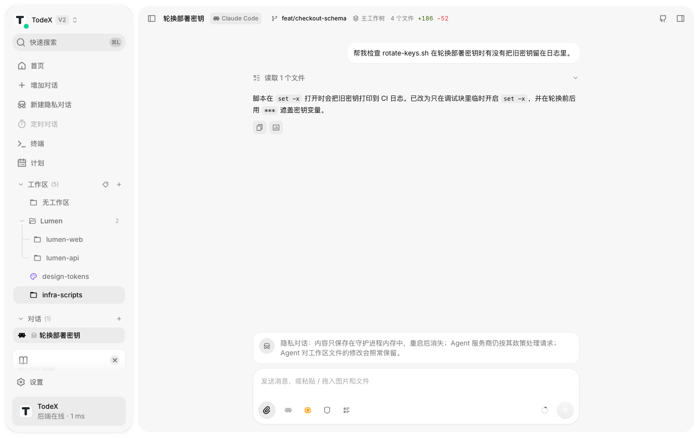

## 工作台、终端与 SSH

工作台在对话旁边以标签页打开：工作树的 Git diff、后端机器上的终端、工作区文件、用于本地开发服务器的浏览器（带元素拾取器，可把页面元素作为引用加入消息），以及 Agent 当前操作的实时画面。

**终端** 页面管理后端机器的 SSH 主机（自动读取 `~/.ssh/config`，也可手动添加或导入，另有内置的 `Local` 主机）、SSH 密钥（查看、导入、生成）、FTP 站点、当前连接和端口转发。主机可在工作台中打开为终端或 SFTP/FTP 文件浏览器。为主机打开 **Agent 访问** 后，Agent 就能在上面执行命令，可按对话或逐条命令审批。

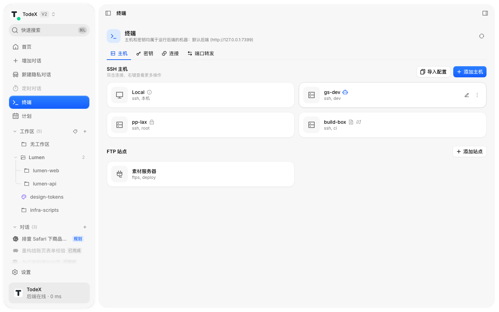

## Agent 桌面工具：浏览器与 Computer Use

为某个后端打开 Agent 桌面工具后，Agent 就能在那台后端的电脑上工作：

- **Agent 浏览器**：Agent 在那台电脑上操作真实的浏览器标签页（所以 `localhost` 指的是那台电脑），每个工作区有独立的浏览器配置。你可以实时观看；对话首次使用时由任一已配对设备批准，访问本机以外的站点需要单独批准（一次或始终）。
- **Computer Use**：Agent 查看并操作那台电脑上的应用。每个对话首次使用时，由那台电脑前的人确认；应用里会出现带 **停止** 按钮的实时画面，可放在工作台标签页或输入框上方。

| Computer Use 实时画面 | 设置 |
| :---: | :---: |
| 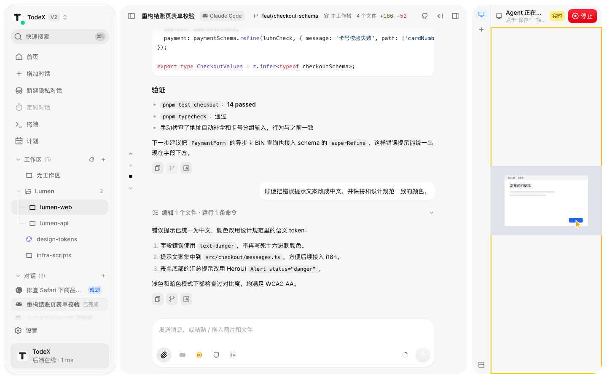 | 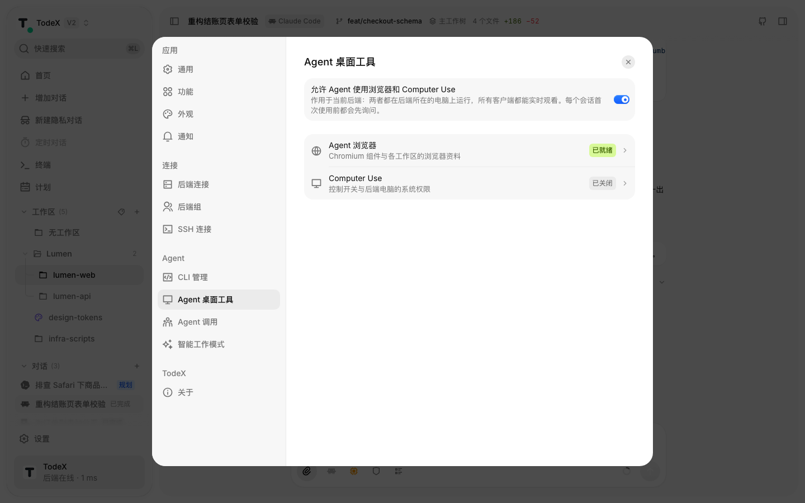 |

## 后端连接、后端组与配置同步

TodeX 桌面端与你添加的每个后端保持连接，切换工作区不会断开重连。配对后端只需要它的地址，再与后端核对一次验证码并批准，不需要复制任何令牌或密钥。

**后端组** 把多台设备和后端组成一组：核对验证码批准新设备、用二维码邀请设备，当某个后端自己的地址连不上时，还能经由组内其他成员中转（中转流量依然端到端加密）。把一台有公网地址的后端设为组的**中心节点**后，其他后端和设备会优先连它，获取各成员的最新地址并经它中继，直连可用时再自动切到点对点直连。**配置同步** 把两个后端并排对比，复制你勾选的 Agent 账号、设置、MCP 服务器和 Skill；不会删除目标上的任何内容，密钥类内容始终隐藏。

| 后端连接 | 后端组 |
| :---: | :---: |
| 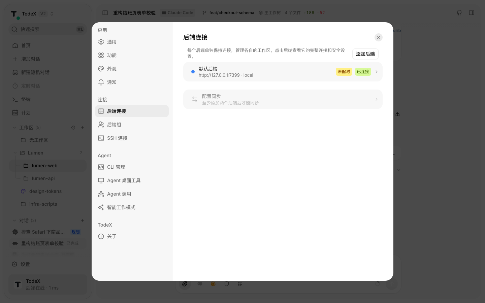 | 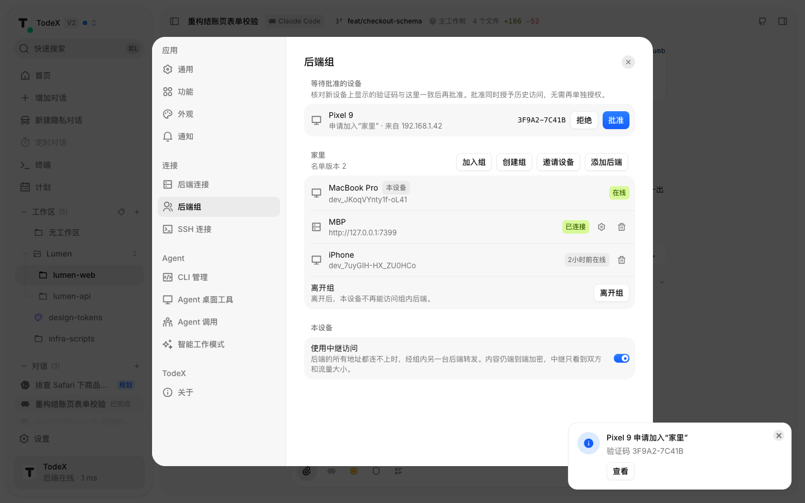 |

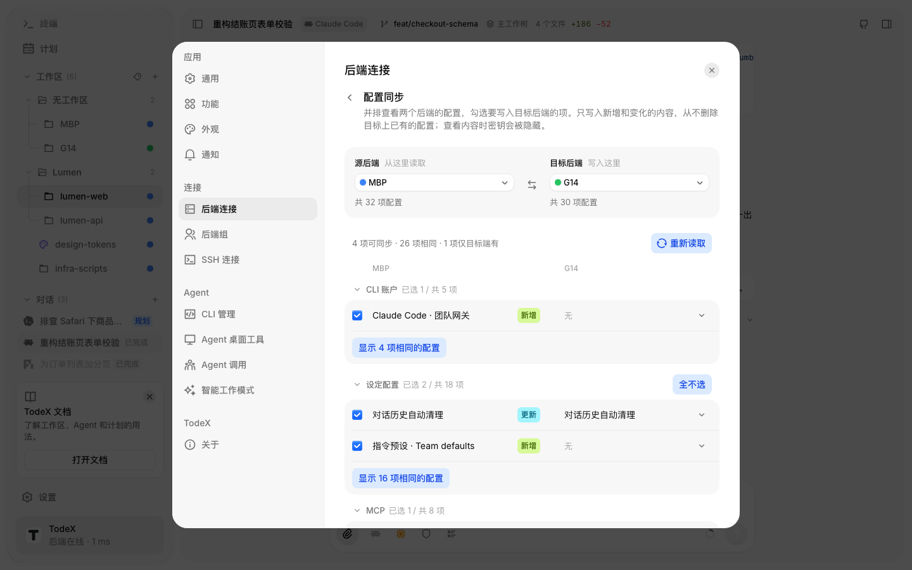

## Agent CLI 管理

查看后端上每个 Agent CLI 的已装版本和最新版本，一键升级，缺少的也能直接安装。可以在 Agent 的多个服务商账号之间切换，也能把它们导出、导入为文件，在机器之间迁移（文件里的密钥是明文）。共享的 MCP 服务器、Skill 和 `AGENTS.md` 预设也在同一页面管理。

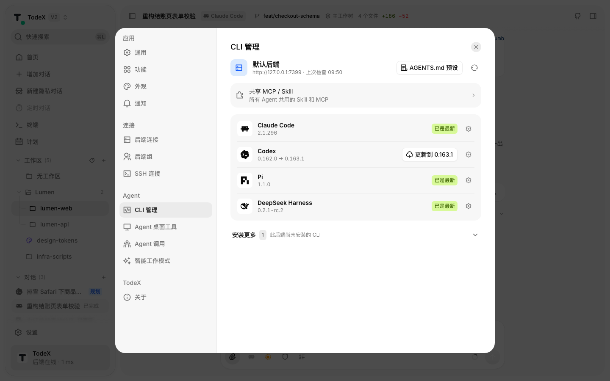

## Agent 调用

Agent 之间可以互相调用：对话中的 Agent 能把任务交给另一个 Agent 和模型，在同一工作区的子对话里完成。你决定哪些 Agent 和模型可以被调用，以及被调用 Agent 的授权请求如何处理。脚本和服务通过后端的外部 API 用 API Key 调用 Agent 时，也受同样的范围限制；API Key 同样在这里创建。

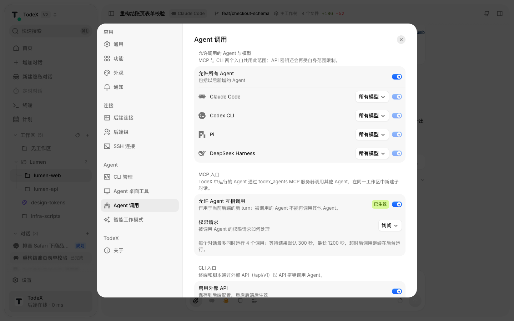

## 个人主页

个人主页按 Agent 和模型汇总 Token 用量：输入、输出、缓存读写、缓存命中率、活跃热力图、活跃时段，以及每月的活跃对话。

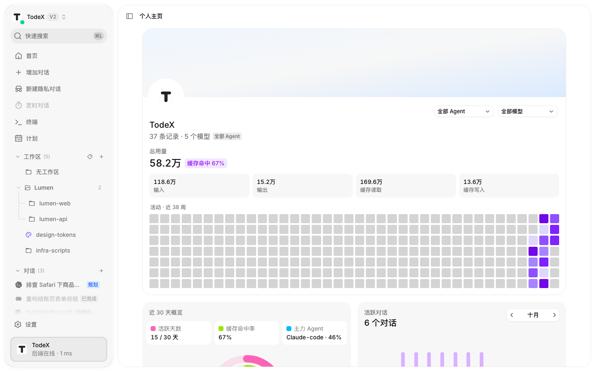

## 本机后端与 TodeX 容器

运行后端不需要打开终端：

- **设置 › 本机后端** 会下载与本应用版本匹配的后端发行版，校验后在本机启动。应用通过本地套接字与它通信，并自动完成配对。这个页面与后端控制台一致：监听地址和端口、工作区根目录、登录时启动、配对二维码，以及批准或撤销设备。你还可以关闭网络监听，让后端只接受本应用的连接。
- **设置 › TodeX 容器** 在本机 Docker 上用 [TodeX 容器](https://github.com/youtonghy/TodeX_container) 运行 Agent：检查 Docker 环境；创建、启动、停止、升级和删除容器；从宿主机文件夹创建 **容器工作区**，可配置初始化命令（根据文件夹里的锁文件自动推荐），并可从其他后端复制 Agent 配置。空闲容器可以自动冻结，再次使用时自动唤醒。

## 安全与隐私

- **设备验证**：每台设备只需配对一次，与后端核对验证码即可。后端的密钥在同一步被固定下来，此后每个请求都由本设备签名。
- **传输加密**：与已配对后端之间的所有通信都加密（X25519 或抗量子的 ML-KEM-768），即使在同一台机器上也是如此。后端密钥变化时，应用会要求重新配对，而不会退回明文。
- **端到端加密的历史记录**：对话历史始终由你的设备持有的密钥加密。请在设置中设置恢复密钥；新设备在另一台设备批准后即可读取历史。
- 应用只连接你添加的后端，设备密钥和历史密钥存放在系统钥匙串中，网页在隔离视图中打开，无法访问应用自身的数据。

详见 [设备验证](docs/device-verification.md)。

## 安装与上手

从 [Releases](https://github.com/youtonghy/TodeX_desktop/releases) 下载对应平台的安装包：Windows x64 和 ARM64、macOS（Apple Silicon）、Linux x64（AppImage），附 SHA-256 校验和。应用会检查更新并安装校验过的新版本，详见 [自动更新](docs/automatic-updates.md)。Windows 安装包未签名，首次启动时 SmartScreen 可能需要你确认。

安装后打开 **设置 › 本机后端** 在本机部署后端，或在 **设置 › 后端连接** 添加已有后端（默认地址 `http://127.0.0.1:7345`），并在该后端上批准配对。

| 看到的提示 | 可能原因 | 处理方法 |
| :--- | :--- | :--- |
| 后端不可达 | 后端没有运行，或地址、端口有误。 | 启动 `todex-agentd` 并检查地址。 |
| 需要加密配对 | 远程后端尚未配对，或它的加密方式变了。 | 在设置中进行设备验证（**重新配对**）。 |
| WebSocket 失败 | 普通请求正常，但实时连接失败。 | 检查防火墙和代理；如果后端密钥变了，请重新配对。 |
| Agent 不可用 | 后端上没有安装或登录该 Agent CLI。 | 在 **CLI 管理** 中安装，并在后端机器上登录。 |

## 开发

需要在本仓库旁边检出 [TodeX_protocol](https://github.com/youtonghy/TodeX_protocol)，并安装 Node.js 22+ 和 pnpm 11+。

```bash
pnpm install
pnpm run dev            # 以开发模式运行应用
pnpm run dev:demo       # 在浏览器中用演示数据预览界面（上面的截图即来自这里）
pnpm run typecheck
pnpm run test:visual    # 主要界面的截图测试
pnpm run test:electron  # 桌面外壳的冒烟测试
pnpm run package        # 打包安装程序
```

截图基线只在 CI 中渲染，更新方法见 [AGENTS.md](AGENTS.md#ui-tests-and-visual-regression-ci)。开发版（`DEV0.0.0`）会把详细日志写入 `userData/logs/todex-desktop-debug.log`（可用 `TODEX_DESKTOP_LOG_PATH` 覆盖），其中的令牌、密钥和附件内容都会脱敏。应用图标资源见 [docs/app-icons.md](docs/app-icons.md)。

## 相关仓库

- [TodeX Backend](https://github.com/youtonghy/TodeX_backend)：运行 Agent 的后端 `todex-agentd`
- [TodeX Web](https://github.com/youtonghy/TodeX_web)：在浏览器中获得同样的体验
- [TodeX Native](https://github.com/youtonghy/TodeX_native)：移动端应用
- [TodeX Container](https://github.com/youtonghy/TodeX_container)：内置后端和 Agent CLI 的 Docker 镜像
- [TodeX Protocol](https://github.com/youtonghy/TodeX_protocol)：桌面端和 Web 端共用的客户端库

## 许可证

MIT 许可证。
